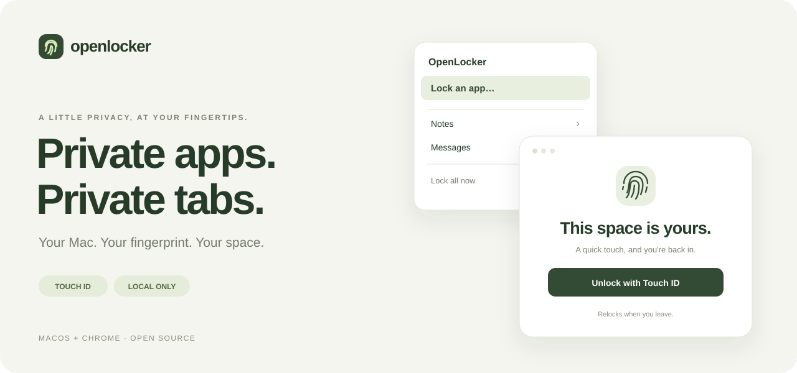

<p align="center">
  
</p>

<p align="center">
  <a href="https://github.com/00cyre/openlocker/releases/download/v0.1.4/OpenLocker-0.1.4-macOS.dmg"></a>
</p>

<p align="center">
  <a href="https://github.com/00cyre/openlocker/releases/tag/v0.1.4">Release notes</a> ·
  <a href="#get-started">Get started</a> ·
  <a href="docs/INSTALL.md">Installation help</a> ·
  <a href="docs/DEVELOPMENT.md">Build from source</a>
</p>

<p align="center">
  <a href="https://github.com/00cyre/openlocker/actions/workflows/ci.yml"></a>
  <a href="LICENSE"></a>
  
  
</p>

**OpenLocker puts your Mac apps and Chrome websites behind Touch ID.** Pick what you want to keep private, then use your fingerprint to get back in. No account. No cloud. No password to remember.

| On your Mac | In Chrome |
| :--- | :--- |
| Click the menu-bar icon → **Lock an app** → click a window. | Click the toolbar icon → **Lock this site**. |
| Protects the whole app, including its other windows. | Protects the domain and its subdomains. |
| Relocks when you switch apps, hide it, or minimize a window. | Relocks when you switch tabs or Chrome windows. |
| Touch ID to unlock, stop protecting, or quit OpenLocker. | Touch ID to unlock or remove a protected domain. |

## Get started

**macOS 13+ · enrolled Touch ID · Apple Silicon or Intel**<br>
Chrome 120+ is needed only for website locking.

1. **[Download OpenLocker](https://github.com/00cyre/openlocker/releases/download/v0.1.4/OpenLocker-0.1.4-macOS.dmg)**, open the disk, and launch **Install OpenLocker**.
2. Click **Install OpenLocker**. The Mac app, Chrome extension, and Touch ID helper are installed for your user. No Terminal, Xcode, or admin password.
3. Choose your setup:

   - **Mac apps:** click **Open OpenLocker**. Use its menu-bar icon, choose **Lock an app**, and allow Accessibility when asked. Click a window to protect its app.
   - **Chrome websites:** choose **Install Chrome extension…** in the Mac app (or **Copy folder path & open Chrome** in the installer). Turn on **Developer mode**, click **Load unpacked**, then press **⇧⌘G** and paste the copied path. Pin the extension.

> **About the one-click installer:** the button above downloads a ready-to-run installer. It installs all local components with one button. macOS still asks you to approve Accessibility, and Chrome requires the final **Load unpacked** step until a Chrome Web Store version exists.
>
> **Signing:** `0.1.4` uses a persistent self-signed identity, not Apple notarization. Updates reuse the same identity to retain Accessibility approval. Upgrading from `0.1.0` needs one renewal, guided by the app. macOS may block its first launch. See [installation help](docs/INSTALL.md#macos-blocked-the-installer) for Apple's approval steps; the installer never disables Gatekeeper.

Prefer a ZIP? [Download the Mac installer ZIP](https://github.com/00cyre/openlocker/releases/download/v0.1.4/OpenLocker-0.1.4-macOS.zip). [Checksums](https://github.com/00cyre/openlocker/releases/download/v0.1.4/SHA256SUMS.txt) are included with the release.

## Automatic unlock and updates

Opening a locked site or app brings up Touch ID automatically. Cancel to keep it locked; use the visible button to retry.

Both the Mac menu and the extension offer **Update to…** when a newer release is available. Click once to verify and install it; the app relaunches or the extension reloads. If apps are protected, Touch ID confirms the Mac app update. Install 0.1.2 once to get these controls. Source-loaded extensions must first switch to the folder prepared by **Install Chrome extension…**.

## Quietly local

- **Your fingerprint stays with macOS.** OpenLocker receives only the authentication result. No password or Apple Watch fallback.
- **Your choices stay on your Mac.** Protected apps and domains are stored locally. No telemetry, accounts, or subscriptions. Update checks fetch public GitHub release information; installation requires your action.
- **No destructive locking.** Mac apps stay in place behind input-blocking blur panels. Chrome locking replaces the open page, so save browser drafts first.
- **You're in control.** Lock everything immediately from either menu. Mac app locking runs while the menu-bar app is open; **Start at login** is optional.

## What this protects

OpenLocker is a **convenience privacy lock**, not an OS security boundary. The Mac app reacts to window/focus events, so a window can briefly appear before its blur panel is positioned. Mission Control, app-switcher previews, notifications, and other macOS surfaces may show app content. Unusual windows, Spaces, and full-screen transitions may not be covered reliably.

Someone who can stop OpenLocker, disable the Chrome extension, edit local files, or use another browser/profile can bypass it. It does not encrypt app data or prevent app launches. Any fingerprint enrolled for your macOS user can authenticate.

Chrome's internal pages, the Web Store, incognito, and other profiles are outside the extension's scope. Locked domains may also block embeds in other tabs. [Full privacy details](PRIVACY.md) · [Security model](SECURITY.md)

## Under the hood

Plain JavaScript for Chrome. Swift and AppKit on the Mac. Apple's `LocalAuthentication` for Touch ID. Zero npm dependencies.

```sh
npm test                  # Chrome policy and worker tests
npm run check             # Manifest, syntax, and asset validation
npm run build:installer   # Universal Mac app + helper + graphical installer
npm run test:mac          # Mac lock policy, relocking, and stale-auth tests
npm run test:installer    # Isolated install/upgrade and artifact checks
npm run test:native       # Native messaging protocol checks
```

[Developer guide](docs/DEVELOPMENT.md) · [Manual acceptance tests](docs/TESTING.md) · [Report an issue](https://github.com/00cyre/openlocker/issues)

Automated checks validate the lock policies, protocol, installation, and builds. Physical fingerprint authentication and real-app minimize/focus behavior still require the manual acceptance tests.

---

<p align="center">Made for a little more privacy on your own Mac.<br><a href="LICENSE">MIT licensed</a> · <a href="https://github.com/00cyre">00cyre</a></p>
